  

 

<h2 align="center">⟡ things I've built ⟡</h2>

 

<h2 align="center">⟡ the toolbox ⟡</h2>

   
   
  

<b>🧪 the AI side (click)</b>

 

`LangChain` · `LangGraph` · `Qdrant` · `Hugging Face` · `TorchServe` · `RAG` · `agentic workflows` · `STT / TTS` · `voice cloning` · `RL trading (SAC)` · `LLM evals`

 

<h2 align="center">⟡ eating my contribution graph ⟡</h2>

  <picture>
    <source media="(prefers-color-scheme: dark)" srcset="https://raw.githubusercontent.com/aayushdebugging/aayushdebugging/output/snake-dark.svg"/>
    <source media="(prefers-color-scheme: light)" srcset="https://raw.githubusercontent.com/aayushdebugging/aayushdebugging/output/snake-light.svg"/>
    
  </picture>

  

